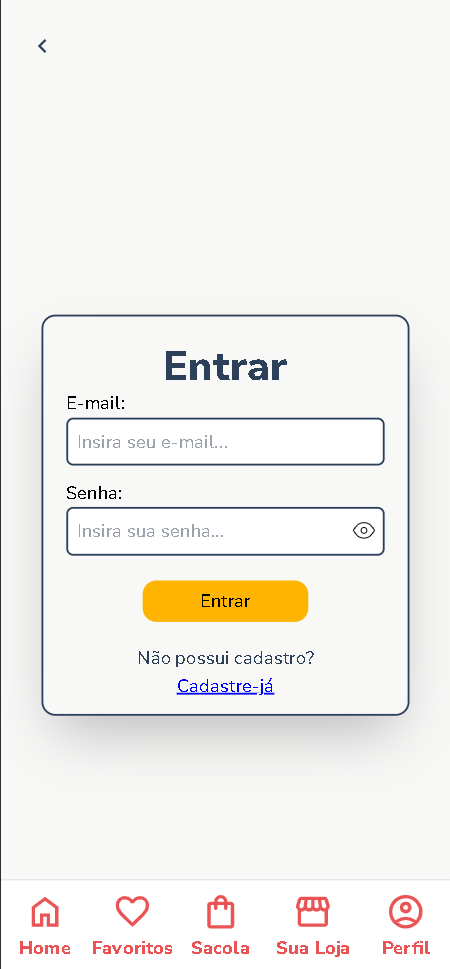
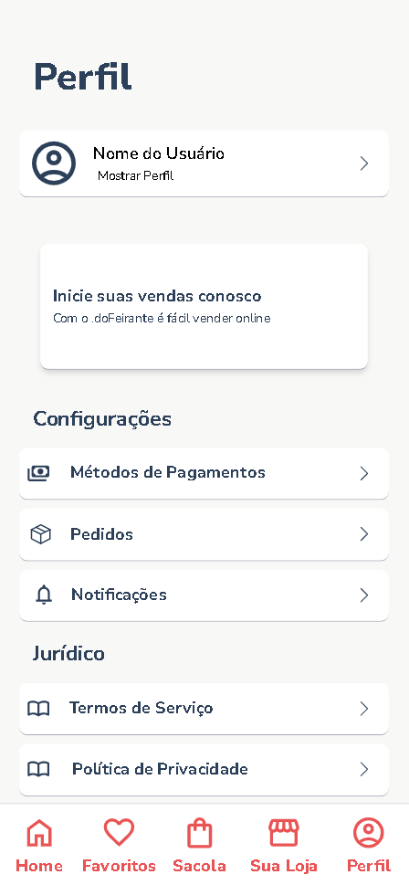

# Ponto do Feirante - In Progress

Este projeto foi desenvolvido durante a disciplina de Fábrica de Software na faculdade, com o objetivo de oferecer aos pequenos feirantes uma nova oportunidade de ampliar suas vendas sem precisar sair de casa. Para isso, criamos um e-commerce acessível e eficiente, conectando produtores e consumidores de forma prática e digital.

# Layouts Principais
<div style="display: inline-block">



</div>
  


# 🚀 Tecnologias utilizadas

Este projeto foi desenvolvido com as seguintes tecnologias:

## Frontend 
- React

- HTML

- CSS

- JS

- Tailwind

## Backend
- Node Js

- Prisma ORM

- PostgreeSQL

# 📦 Instalação

Para instalar e rodar o projeto localmente, siga os passos abaixo:

```bash
# Clone este repositório
git clone https://github.com/adrianolucasdc/pontodofeirante.git

# Acesse a pasta do projeto
cd pontodofeirante

# Acesse a pasta do frontend
cd frontend

# Instale as dependências
npm install

# Execute o frontend
npm run dev 

# Abra outro terminal
# Acesse a pasta do backend
cd backend

# Instale as dependências
npm install

# Execute o backend
npm run dev 

# A aplicação estará rodando na url: http://localhost:3000
```

## 📌 Funcionalidades (Concluidas)

- Cadastro / login do consumidor e forncedor

## 📝 Licença

Este projeto está sob a licença MIT. Veja o arquivo LICENSE para mais detalhes.

Feito por Adriano Lucas e Davi Ramos.

